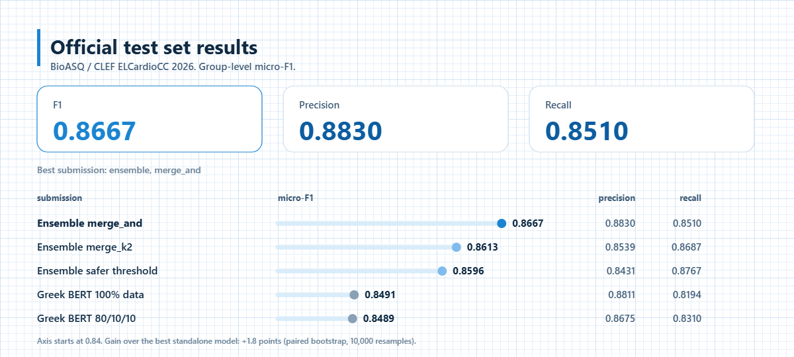
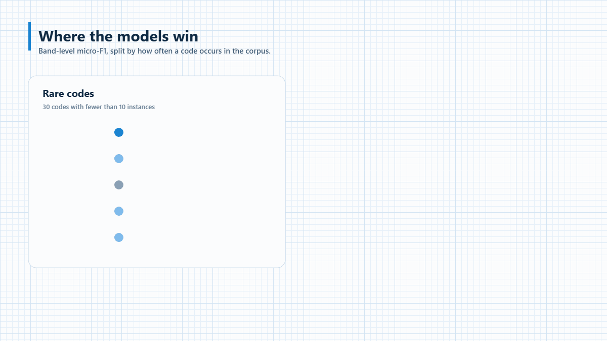
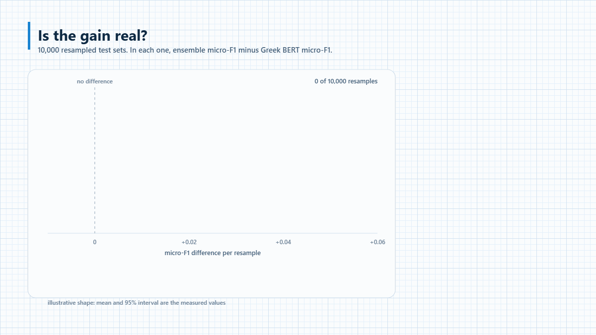
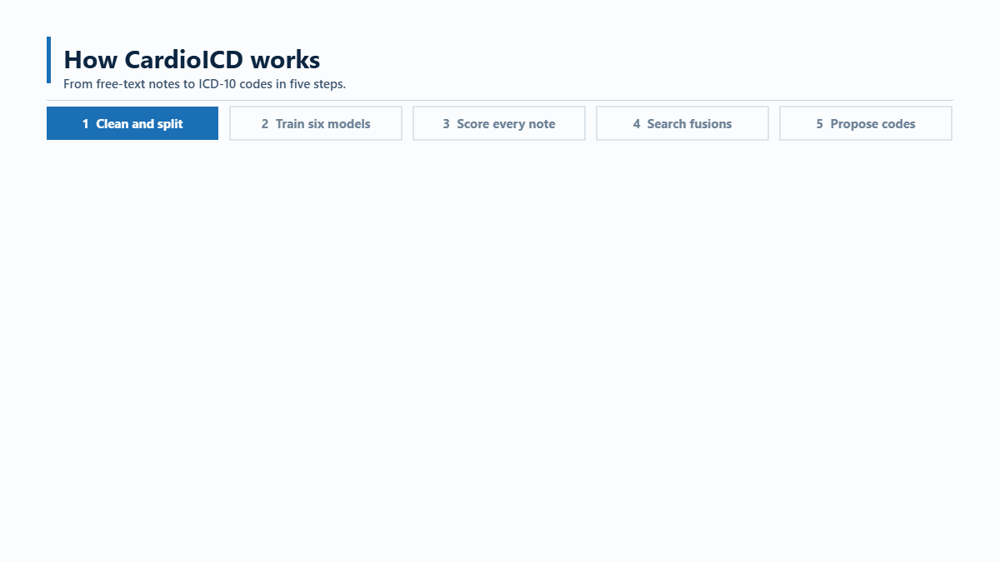

<h1 align="center">CardioICD</h1>

<p align="center">
  <b>Automatic ICD-10 coding of Greek cardiology discharge summaries.</b><br>
  Six models, fused by a metaheuristic search. <b>1st place</b> at BioASQ / CLEF ELCardioCC 2026, micro-F1 <b>0.8667</b>.
</p>

<p align="center">
  <a href="https://straf10.github.io/CardioICD/"></a><br>
  <sub>Runs in the browser, nothing to install: see the predicted codes and their evidence on example discharge summaries.</sub><br><br>
  <a href="https://ceur-ws.org/Vol-4283/paper43.pdf"></a>
</p>

<p align="center">
  
</p>

A cardiologist writes a discharge summary in free-text Greek. Someone must then read it and assign the ICD-10 codes. The codes serve the hospital record, reimbursement and national health statistics. This work is slow and done by hand.

**CardioICD reads the summary and proposes the codes.** The system marks the spans it uses, and each span resolves into an ICD-10 code. No real patient text is in this repository (see [DATA.md](data/DATA.md)).

> Built for the [BioASQ / CLEF ELCardioCC 2026](http://bioasq.org/) shared task, as part of the
> **AIDA** (AI and Data Analytics) postgraduate programme at the
> [University of Macedonia](https://www.uom.gr).

The task is multi-label classification over **115 target codes** and 2,500 documents. Greek word forms, Latin terms inside Greek text, long documents and rare codes make it hard. Scoring is group-level micro-F1: a gold group counts as found when the system predicts any one of its codes.

---

## Results

<p align="center">
  
</p>

The final results of the shared task. The ensemble beats the best single model by **1.8 points**. The next section shows why this gap is not noise.

---

## Where the models win

<p align="center">
  
</p>

On rare codes, the rule-based parts beat every neural model. On frequent codes, the order flips. The ensemble is tuned for overall micro-F1, so it does not recover the long tail. This is the main direction for future work.

## Is the gain real?

<p align="center">
  
</p>

A paired bootstrap on the test set gives a mean gain of +0.0323. No resample out of 10,000 favours Greek BERT alone. A McNemar test agrees (88 groups against 21).

---

## How it works

<p align="center">
  
</p>

Each component is a package under [`src/`](src/) with its own YAML config. The five steps in the animation run as the commands in [Quickstart](#quickstart).

---

## Quickstart

```bash
git clone https://github.com/straf10/CardioICD.git
cd CardioICD
python -m venv .venv && source .venv/bin/activate   # Windows: .venv\Scripts\activate
pip install -r requirements.txt
```

Python 3.10+. The clinical text is **not** in this repo. Get it from the task organizers and put it under `data/raw/` as [DATA.md](data/DATA.md) describes.

Every subsystem is a module with a YAML config. Run it from the repository root:

```bash
# 1. clean and flatten the raw JSONL
PYTHONPATH=src python -m preprocessing

# 2. multi-label stratified 80/10/10 split
PYTHONPATH=src python -m split_data --config src/split_data/split.yaml

# 3. train a component (each has its own config)
PYTHONPATH=src python -m mlc_greek_bert.train --config src/mlc_greek_bert/mlc_greek_bert.yaml

# 4. run every trained component over the splits
PYTHONPATH=src python -m evaluation.run_predictions

# 5. search for the best fusion of their outputs
PYTHONPATH=src python -m ensemble_metaheuristic
```

<details>
<summary><b>All configuration files</b></summary>

<br>

| Config | Subsystem |
|---|---|
| `src/split_data/split.yaml` | Stratified splitting |
| `src/mlc_greek_bert/mlc_greek_bert.yaml` | Greek BERT (`sweep_config.yaml` for W&B sweeps) |
| `src/xlm_r_large/xlm_r.yaml` | XLM-RoBERTa Large |
| `src/xlm_r_base/xlm_r_base.yaml` | XLM-RoBERTa Base |
| `src/dictionary/dictionary.yaml` | Dictionary baseline |
| `src/ner_el/ner_el.yaml` | NER + entity linking |
| `src/ensemble_metaheuristic/strategy_compositions.yaml` | Ensemble search space |
| `src/evaluation/config.yaml` | Evaluation and prediction runner |

To run one fusion strategy or ablation, use for example
`python -m ensemble_metaheuristic.strategies.weighted_strategy --help` or
`python -m ensemble_metaheuristic.weighted_subset_sweep`.

</details>

---

## Repository layout

```
src/                    one package per component, each with its own YAML config
data/                   labelset, ICD-10 Greek lookup, mined dictionaries, data card (no patient text)
report/                 paper figures
docs/                   live demo page, and docs/readme-demo/ (source of the animations)
assets/readme/          the animations and the results card
```

The animations are built by `docs/readme-demo/render.py`. Install `playwright` and `pillow`, run `python -m playwright install chromium`, then run `python docs/readme-demo/render.py`. The data file `docs/readme-demo/data.js` comes from `make_data.py`. It holds aggregate numbers and one synthetic note.

Per-component predictions and blind-test submissions are made locally and are not tracked in git. Without the non-public dataset, nobody can reproduce them.

## Data and privacy

The clinical corpus is not redistributable and is not in this repository. These items are tracked: the 115-code labelset, the ICD-10 Greek description lookup, the mined term-to-code dictionaries and the split statistics. Schema, provenance and split method: **[DATA.md](data/DATA.md)**.

## Paper

*A Multi-Component System for Multi-Label ICD-10 Classification of Greek Cardiology Discharge
Summaries.* BioASQ ElCardioCC at CLEF 2026, CEUR Workshop Proceedings
(Working Notes, Vol. 4283): **[read the paper](https://ceur-ws.org/Vol-4283/paper43.pdf)**.
Figures are in [`report/figures/`](report/figures/).

Nikolaos Strafiotis, Panteleimon Stanimeros, Vasiliki Katsara, Georgios Chalkias,
Glykeria Tsavlidou, Stelios Magalios, Effrosyni Nalmpanti, Panteleimon Stamatakis,
University of Macedonia.

## License

[MIT](LICENSE)
